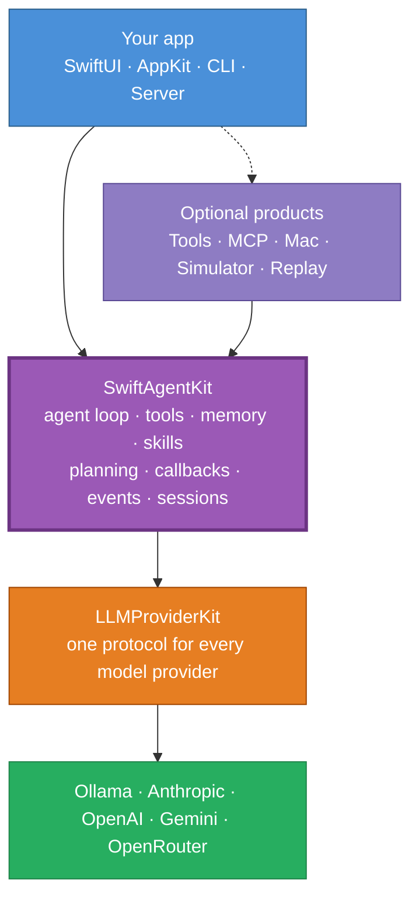

<p align="center">
  <h1 align="center">SwiftAgentKit</h1>
  <p align="center"><strong>Build AI agents in native Swift.</strong></p>
  <p align="center">Give a model your Swift functions as tools, and SwiftAgentKit runs the loop:<br/>the model asks, your code acts, and the model sees the result.</p>
</p>

<p align="center">
  
  
  
  
</p>

<p align="center">
  <a href="#quick-start">Quick start</a> ·
  <a href="#the-essentials">Essentials</a> ·
  <a href="#going-further">Going further</a> ·
  <a href="#examples">Examples</a> ·
  <a href="#built-with-swiftagentkit">Built with it</a>
</p>

<p align="center">
  <a href="https://github.com/ayman3000/SwiftAgentKit/raw/main/Media/SwiftAgentKitExplainer.mp4">
    
  </a>
  <br/>
  <a href="https://github.com/ayman3000/SwiftAgentKit/raw/main/Media/SwiftAgentKitExplainer.mp4"><strong>▶ Watch the 74-second overview</strong></a>
</p>

---

```swift
let agent = Agent(config: AgentConfig(
    provider: OllamaProvider(configuration: OllamaProvider.local(model: "llama3.2")),
    systemPrompt: "You are a helpful assistant. Use tools when needed.",
    tools: [CurrentTimeTool()]
))

print(try await agent.run("What time is it?"))
// The model calls current_time, your Swift code runs, and the model answers from the result.
```

## Why SwiftAgentKit

- **Native Swift.** Actors, async/await and Swift 6 concurrency throughout. This is not a wrapper around a Python framework.
- **Local or cloud.** Run fully offline on **Ollama**, or switch to **Anthropic**, **OpenAI**, **Gemini** or **OpenRouter** by changing one line.
- **Use only what you need.** The core library depends on Foundation and [LLMProviderKit](https://github.com/ayman3000/LLMProviderKit), nothing else. Ready-made tools, MCP, Mac automation and Simulator automation are separate, opt-in products.
- **Built for real apps.** It powers [Naseem](https://naseemformac.com), a Mac AI agent. Hooks, events and cancellation are there for building a real UI.

---

## Quick start

### 1. Add the package

In Xcode, choose **File ▸ Add Package Dependencies…** and add both:

```
https://github.com/ayman3000/SwiftAgentKit
https://github.com/ayman3000/LLMProviderKit
```

Or, in `Package.swift`:

```swift
dependencies: [
    .package(url: "https://github.com/ayman3000/SwiftAgentKit.git", from: "0.4.0-alpha.133"),
    .package(url: "https://github.com/ayman3000/LLMProviderKit.git", from: "0.1.0-alpha.43"),
],
targets: [
    .target(name: "YourApp", dependencies: [
        .product(name: "SwiftAgentKit", package: "SwiftAgentKit"),
        .product(name: "LLMProviderKit", package: "LLMProviderKit"),
        .product(name: "LLMProviderKitOllama", package: "LLMProviderKit"),   // or Anthropic, OpenAI, Gemini, OpenRouter
    ])
]
```

### 2. Write a tool

A tool is a Swift type that conforms to `AgentTool`. It has a name, a description the model reads, a JSON Schema for its parameters, and an `execute` method.

```swift
import SwiftAgentKit

struct CurrentTimeTool: AgentTool {
    let name = "current_time"
    let description = "Return the current date and time."
    let parameters = ToolParameters.empty
    var isReadOnly: Bool { true }

    func execute(context: ToolContext) async throws -> AgentToolResult {
        .success(toolCallId: context.callId, toolName: name,
                 result: Date().formatted(date: .complete, time: .standard))
    }
}
```

### 3. Run an agent

```swift
import SwiftAgentKit
import LLMProviderKitOllama

let agent = Agent(config: AgentConfig(
    provider: OllamaProvider(configuration: OllamaProvider.local(model: "llama3.2")),
    systemPrompt: "You are a helpful assistant. Use tools when needed.",
    maxTurns: 6,
    tools: [CurrentTimeTool()]
))

let answer = try await agent.run("What time is it?")
print(answer)
```

This is a complete agent. `run` sends the conversation and tool definitions to the model, runs the tool calls it gets back, returns the results to the model, and repeats until the model gives a final answer or `maxTurns` is reached.

> **Need a model?** Run `ollama pull llama3.2` and you're ready, with no API key.

---

## The essentials

### Tools with parameters

Read arguments from `context.parameters`. When something goes wrong that the model can fix, such as a missing or invalid argument, return `.error(…)`. The model reads the message and tries again.

```swift
struct WeatherTool: AgentTool {
    let name = "get_weather"
    let description = "Get the current weather for a city."
    let parameters = ToolParameters(
        properties: ["city": ToolParameterProperty(type: "string", description: "City name, e.g. Cairo")],
        required: ["city"]
    )
    var isReadOnly: Bool { true }

    func execute(context: ToolContext) async throws -> AgentToolResult {
        guard let city = context.parameters["city"] as? String, !city.isEmpty else {
            return .error(toolCallId: context.callId, toolName: name, message: "`city` is required.")
        }
        return .success(toolCallId: context.callId, toolName: name, result: "Sunny, 24°C in \(city)")
    }
}
```

| Tool property | Default | Use it when |
|---|---|---|
| `isReadOnly` | `false` | the tool only reads. Read-only calls can run in parallel, and are retried once after a temporary failure. |
| `requiresConfirmation` | `false` | the tool can cause damage, such as deleting files or running shell commands. The agent asks `onToolConfirmation` before running it. |
| `inputExamples` | `[]` | the model needs to see the exact format of an argument, such as a date or an ID. |

Register tools when you create the agent (`tools: [...]`), or later with `await agent.register(tool)`.

### Switch providers

The agent code stays the same. Only the provider changes:

```swift
import LLMProviderKitAnthropic
import LLMProviderKitOpenAI
import LLMProviderKitGemini

let local  = OllamaProvider(configuration: OllamaProvider.local(model: "llama3.2"))
let claude = AnthropicProvider(configuration: AnthropicProvider.anthropic(apiKey: key, model: "claude-sonnet-5-5"))
let gpt    = OpenAIProvider(configuration: OpenAIProvider.openAI(apiKey: key, model: "gpt-5"))
let gemini = GeminiProvider(configuration: GeminiProvider.gemini(apiKey: key, model: "gemini-2.5-pro"))
```

| Provider | Tool calling | Streaming | Model list |
|---|---|---|---|
| **Ollama** (local) | ✅ | ✅ | ✅ |
| **Anthropic** | ✅ | ✅ | ✅ |
| **OpenAI** | ✅ | ✅ | ✅ |
| **Gemini** | ✅ | ✅ | ✅ |
| **OpenRouter** | ✅ | ✅ | ✅ |

### Stream the answer

```swift
for try await chunk in agent.runStreaming("Explain Swift actors in three sentences.") {
    print(chunk, terminator: "")
}
```

`runStreaming` runs the same loop as `run`, including tools, planning and callbacks. While a tool call is in progress you won't see text tokens; the answer text streams as it arrives. To stop a run, call `agent.requestCancel()`, or cancel the task that's reading the stream.

### Watch what happens

Events let you show progress, build a debug panel or keep an audit log:

```swift
agent.onEvent { event in
    switch event {
    case .toolCallsReceived(let calls):
        print("→", calls.map(\.name).joined(separator: ", "))
    case .toolExecutionFinished(let call, let result):
        print(result.isError ? "✗" : "✓", call.name)
    case .finished(let summary):
        print("Done in \(summary.totalTurns) turns, \(summary.toolsExecuted) tool calls")
    default:
        break
    }
}
```

### Add guardrails

Callbacks run at each stage of the loop. A callback can observe what happens, or change or block it.

```swift
var callbacks = AgentCallbacks()

// Ask the user before any tool marked requiresConfirmation runs.
callbacks.onToolConfirmation = { call, _ in
    await askUser("Allow \(call.name)?")
}

// Block a tool outright.
callbacks.beforeTool = { call, _ in
    call.name == "delete_file"
        ? .error(toolCallId: call.id, toolName: call.name, message: "Blocked by policy.")
        : nil
}

// Change the final answer before it's returned.
callbacks.afterAgent = { response, _ in
    response.trimmingCharacters(in: .whitespacesAndNewlines)
}

try await agent.setCallbacks(callbacks)
```

The full set of callbacks: `beforeAgent`, `afterAgent`, `beforeModel`, `afterModel`, `beforeTool`, `afterTool`, `onModelError`, `onToolError` and `onToolConfirmation`.

---

## Going further

Each of these is opt-in. Click a section to expand it.

<details>
<summary><strong>🧰 Ready-made tools</strong>: files, shell, Python, web, PDF, Office</summary>

<br/>

Add the `SwiftAgentKitTools` product:

```swift
import SwiftAgentKitTools

let policy = FileToolPolicy(allowedRoots: [projectURL])   // keep file tools inside one folder

let agent = Agent(config: AgentConfig(
    provider: provider,
    tools: [
        FileReadTool(policy: policy),
        FileWriteTool(policy: policy),
        EditFileTool(policy: policy),
        ListDirTool(policy: policy),
        SearchFilesTool(policy: policy),
        FetchURLTool(),
    ]
))
```

| Group | Tools |
|---|---|
| Files | `FileReadTool`, `FileWriteTool`, `EditFileTool`, `PatchFileTool`, `ListDirTool`, `SearchFilesTool` |
| Code | `ShellTool`, `PythonTool` |
| Web | `FetchURLTool` |
| Documents | `PDFInfoTool`, `PDFExtractTextTool`, `PDFMergeTool`, `PDFSplitTool`, `OfficeExtractTextTool`, `DocumentDigestTool` |
| Slack | `SlackChannelsTool`, `SlackHistoryTool`, `SlackSearchTool`, `SlackPostTool`, … |

Built-in safety features:

- `FileToolPolicy` resolves `~`, `..` and symlinks before it checks whether a path is allowed.
- The shell and Python tools stop the command and everything it started when it times out.
- `import_skill` refuses private and loopback URLs.

</details>

<details>
<summary><strong>🧠 Memory</strong>: facts that carry over between sessions</summary>

<br/>

```swift
let store = FileAgentMemoryStore.defaultStore(named: "myapp")   // ~/.myapp/
try await agent.setMemoryStore(store)
```

Attaching a store adds what the agent remembers to the system prompt, and registers a `remember` tool so the agent can save new facts. Everything is stored as readable Markdown:

```
~/.myapp/
├── AGENT.md      who the agent is
├── USER.md       what it knows about the user
├── MEMORY.md     index of facts
└── memory/       one file per fact
```

</details>

<details>
<summary><strong>🎯 Skills</strong>: instructions loaded only when a task needs them</summary>

<br/>

A skill is a Markdown file with instructions for one kind of task. The agent sees only each skill's name and a one-line description. It loads a skill's full instructions only when the task needs it, which keeps prompts small, especially for local models.

```swift
try await agent.setSkillStore(FileAgentSkillStore.defaultStore(named: "myapp"))
```

This registers `use_skill`, for loading a skill, and `learn_skill`, for saving a new one.

</details>

<details>
<summary><strong>💾 Sessions</strong>: save a conversation and restore it later</summary>

<br/>

```swift
let sessions = FileSessionStore(directory: sessionsURL)

try await agent.saveSession(store: sessions, sessionId: "chat-42")
// …later, possibly after the app relaunches:
let restored = try await agent.loadSession(store: sessions, sessionId: "chat-42")
```

</details>

<details>
<summary><strong>📋 Planning and goals</strong>: for multi-step tasks</summary>

<br/>

```swift
let agent = Agent(config: AgentConfig(
    provider: provider,
    systemPrompt: "You are a careful implementation assistant.",
    maxTurns: 12,
    enablePlanning: true,          // write a plan before acting
    enableRepairRetry: true,       // tell the model when a tool failed, instead of accepting "done"
    enablePlanContinuation: true   // tell the model when it stops before finishing the plan
))

try await agent.setGoalStore(FileAgentGoalStore(directory: goalsURL))
let answer = try await agent.run("Inspect this project and write a README summary.", trackGoal: true)
```

Keep planning off for simple questions and turn it on for multi-step work. Tracked goals record their status, progress and a final summary.

</details>

<details>
<summary><strong>🔌 MCP servers</strong>: use any Model Context Protocol server's tools</summary>

<br/>

Add the `SwiftAgentKitMCP` product:

```swift
import SwiftAgentKitMCP

let mcp = MCPManager()
_ = try await mcp.connect(.stdio(command: "npx", args: ["-y", "@modelcontextprotocol/server-filesystem", "/tmp"]))
_ = try await mcp.connect(.http(endpoint: URL(string: "http://localhost:8080")!))

for tool in try await mcp.bridgedTools() {
    await agent.register(tool)
}
```

Supported: stdio and HTTP servers, tools and resources, and several servers at once. Not yet supported: MCP prompts, sampling and elicitation. SwiftAgentKit is a client only; it doesn't host servers.

</details>

<details>
<summary><strong>🖥️ Mac app automation</strong>: control native apps through Accessibility (macOS)</summary>

<br/>

Add the `SwiftAgentKitMac` product:

```swift
import SwiftAgentKitMac

let tools = makeMacTools(
    allowlistProvider: { allowedBundleIDs },   // the apps this conversation may control
    client: AXClient()
)
await agent.registerAll(tools)
```

Tools: `mac_apps`, `mac_ui` (read an app's UI tree), `mac_click`, `mac_type`, `mac_key`, `mac_wait`, `mac_launch` and `mac_scroll`. `mac_screenshot` is optional.

Three safety checks, all controlled by your app:

1. Mac control is off until your app turns it on.
2. Each conversation has its own list of apps it may control.
3. Your app can require the user to confirm every click, keypress or text entry.

Your app needs Accessibility permission (**System Settings → Privacy & Security → Accessibility**). Check it with `AXPermission.isTrusted()`.

</details>

<details>
<summary><strong>📱 iOS Simulator automation</strong>: build, launch, tap, swipe and screenshot (macOS)</summary>

<br/>

Add the `SwiftAgentKitSimulator` product:

```swift
import SwiftAgentKitSimulator

let client = await SimClient(manager: SimDriverManager(), udid: udid, runtime: runtime)
await agent.registerAll(makeSimulatorTools(session: SimSession(), client: client))
```

Tools include `sim_list`, `sim_boot`, `sim_build_install`, `sim_launch`, `sim_ui`, `sim_tap`, `sim_type`, `sim_swipe`, `sim_wait`, `sim_alert`, `sim_screenshot` and `sim_logs`. The first run builds a small XCUITest driver, which takes 30–60 seconds. Later runs reuse it.

</details>

<details>
<summary><strong>✨ The <code>@Tool</code> macro</strong>: turn a function into a tool</summary>

<br/>

```swift
struct MyTools {
    @Tool("Return the current date and time.")
    func currentTime() async throws -> String {
        Date().formatted(date: .complete, time: .standard)
    }
}

await agent.register(MyTools().currentTimeTool())
```

The macro builds the tool's name (`current_time`) and parameter schema from the function. It supports `String`, `Int`, `Double` and `Bool` parameters, which are always required. For arrays, nested objects or enums, write an `AgentTool` by hand.

</details>

<details>
<summary><strong>🧪 Replay</strong>: deterministic tests without a live model</summary>

<br/>

`SwiftAgentKitReplay` records an agent's traffic with the model once, then plays it back in your tests, so they run fast, offline and give the same result every time.

</details>

---

## Examples

Ten runnable examples, one feature each. They build with the package, so they stay in step with the API.

```bash
swift run Runner        # list them
swift run Runner 02     # run one
```

| # | Example | Shows |
|---|---|---|
| 01 | [HelloAgent](Examples/01-HelloAgent.swift) | the smallest agent |
| 02 | [ToolCalling](Examples/02-ToolCalling.swift) | a Swift tool the model decides to call |
| 03 | [MCPIntegration](Examples/03-MCPIntegration.swift) | tools from an MCP server |
| 04 | [SimpleChat](Examples/04-SimpleChat.swift) | plain text, JSON output and streaming |
| 05 | [CodingQA](Examples/05-CodingQA.swift) | a multi-turn chat with history |
| 06 | [FileAgent](Examples/06-FileAgent.swift) | an agent exploring files |
| 07 | [ProjectScaffolder](Examples/07-ProjectScaffolder.swift) | plan first, then act |
| 08 | [StatefulAgent](Examples/08-StatefulAgent.swift) | state, events, saving sessions |
| 09 | [Guardrails](Examples/09-Guardrails.swift) | blocking tools and redacting output |
| 10 | [Skills](Examples/10-Skills.swift) | skills loaded on demand |

Most examples use Ollama with `llama3.2`. See [Examples/README.md](Examples/README.md) for details.

---

## Built with SwiftAgentKit

| | |
|---|---|
| **[Naseem](https://naseemformac.com)** | A native AI agent for the Mac. It works in your projects, files and apps, with memory, skills, sub-agents, Mac app control and the iOS Simulator. |
| **[sak](https://github.com/ayman3000/sak)** | A coding agent for the terminal, in a few hundred lines. It has five providers, `/model` and `/provider` commands, approval prompts, and a script mode with piped input, `--json` output and exit codes. The best place to see the whole library at work. |

Building something with SwiftAgentKit? [Open an issue](https://github.com/ayman3000/SwiftAgentKit/issues) and we'll add it here.

---

## How it fits together



| Product | What it adds |
|---|---|
| `SwiftAgentKit` | The agent runtime: the loop, the tool protocol, memory, planning, skills, sub-agents and context management |
| `SwiftAgentKitTools` | Ready-made tools for files, shell, Python, web, PDF, Office and Slack |
| `SwiftAgentKitMCP` | An MCP client (stdio and HTTP) |
| `SwiftAgentKitMac` | Mac app control through Accessibility, plus Mail, Notes, Calendar and Contacts |
| `SwiftAgentKitSimulator` | iOS Simulator control |
| `SwiftAgentKitReplay` | Record and replay model traffic for tests |

---

## Status

SwiftAgentKit is in **alpha**. The API may still change before beta.

- **Breaking change in 0.4.0:** `Agent` is now an actor. Configure it when you create it, or with `try await agent.set…(…)` while it's idle.
- One `Agent` handles one `run` at a time.
- How well tools work depends on the model. Small models sometimes ignore a tool even when it's available.

See [CHANGELOG.md](CHANGELOG.md) for every release.

### Build and test

```bash
swift build
swift test
```

The test suite has more than 870 tests across the loop, tools, context management, MCP and replay. None of them use the network.

---

## Contributing

Issues, ideas and pull requests are welcome: [open an issue](https://github.com/ayman3000/SwiftAgentKit/issues) or [send a PR](https://github.com/ayman3000/SwiftAgentKit/pulls).

## License

MIT. See [LICENSE](LICENSE).
